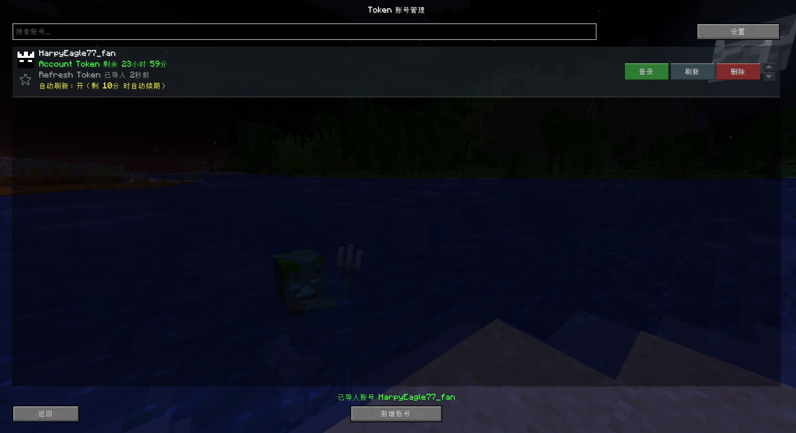

  

<h1 align="center">TokenLogin</h1>

  
  
  

  用 Refresh Token 登录 Minecraft 的 Fabric mod 
  可以储存多个账号和自动刷新Account token 
  可以二次更改，若发布需要通知我且允许 
  前置：Fabric Loader 0.19.5+ 和 Fabric Api 
  其他版本可以自行构建 
  bilibili uid：3493114790546103 UrMomDead 可以联系我
  

  

  ---Mod---
  
  
  

